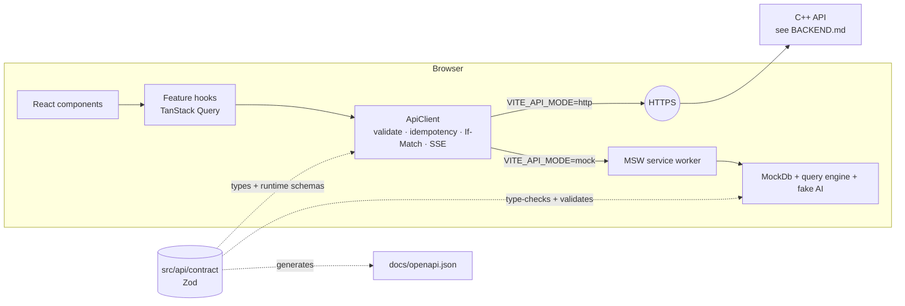
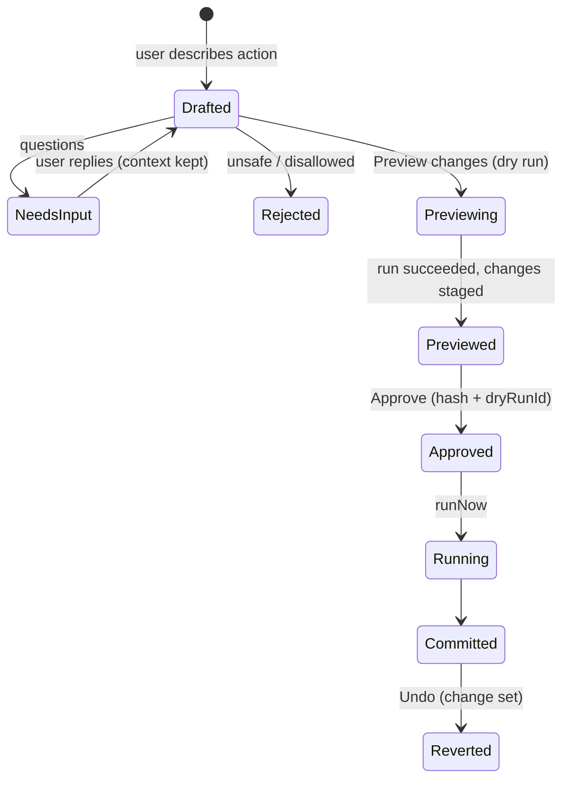

# Lighthouse web client — architecture

This document describes how the web UI is built and why. The backend it needs
is described in [BACKEND.md](./BACKEND.md); the exact wire contract is
[`openapi.json`](./openapi.json), generated from `src/api/contract`.

## 1. Goals and principles

| Goal                                                                           | How it shows up in the code                                                                                                                                                          |
| ------------------------------------------------------------------------------ | ------------------------------------------------------------------------------------------------------------------------------------------------------------------------------------ |
| **The backend is a contract, not an implementation**                           | One Zod contract (`src/api/contract`) drives the typed client, runtime validation, the mock backend, the OpenAPI file and the contract tests.                                        |
| **Nothing reaches the server unvalidated, nothing from it is trusted blindly** | `ApiClient` validates request bodies before sending and every response before returning it; drift surfaces as a `contract_violation` error, not a crash in a component.              |
| **AI proposes, the user approves**                                             | Charts and actions are drafts until confirmed. Actions are previewed (dry run) before approval, approval binds to a content hash, and committed changes can be undone.               |
| **Testable without a backend**                                                 | The same mock backend runs in the browser (dev) and in Node (tests). Pure logic (grid keyboard model, layout ops, chart compilation, value parsing) lives in framework-free modules. |
| **Replaceable parts**                                                          | The grid, chart renderer and dashboard layout engine each sit behind one component/module boundary so they can be swapped (e.g. Handsontable, Vega-Lite) without touching features.  |

## 2. Stack

| Concern               | Choice                                                         | Notes                                                                                                      |
| --------------------- | -------------------------------------------------------------- | ---------------------------------------------------------------------------------------------------------- |
| Framework             | React 19 + TypeScript (strict, `noUncheckedIndexedAccess`)     |                                                                                                            |
| Build                 | Vite 7                                                         | Route-level code splitting; the mock backend is a separate lazy chunk that is never loaded in `http` mode. |
| Routing               | React Router 7 (data router, lazy routes)                      | URLs are shareable: `/w/:workspaceId/{dashboard,data/:datasetId,actions/:actionId}`.                       |
| Server state          | TanStack Query 5                                               | All server data lives in the query cache; there is no global client store.                                 |
| Contract & validation | Zod 4                                                          | Schemas → TS types → JSON Schema/OpenAPI.                                                                  |
| Grid virtualisation   | TanStack Virtual                                               | Rows are server-paged (cursor) and virtualised.                                                            |
| Dashboard layout      | react-grid-layout                                              | 12-column responsive grid, per-breakpoint layouts.                                                         |
| Charts                | In-house SVG/CSS renderers over an app-owned `ChartDefinition` | No chart lib in the bundle; swap point is `features/charts`.                                               |
| Mock backend          | MSW 2                                                          | Service worker in dev, `msw/node` in tests.                                                                |
| Tests                 | Vitest 4 + Testing Library + jsdom                             |                                                                                                            |
| Styling               | CSS Modules + design tokens (`styles/tokens.css`)              | Palette from the design: forest green = data actions, blue = AI, amber = review, red = destructive.        |

## 3. Source layout

```text
src/
  api/
    contract/        ← THE CONTRACT. Zod schemas + endpoint registry + OpenAPI builder
    client/          ← ApiClient (fetch, validation, errors, SSE), ApiError
    ApiProvider.tsx  ← dependency injection of the client
    queryKeys.ts     ← every TanStack Query key, hierarchical
  app/               ← composition root: config, services, providers, router, shell
  features/
    workspace/       ← session + workspace queries and context
    dashboard/       ← dashboard page, grid, widget cards, pure layout ops
    charts/          ← ChartDefinition → model compiler, renderers, AI chart builder
    data/            ← Data view, virtualised grid, record drawer, schema editor, filters
    actions/         ← actions page, schedule editor, run details, hooks (incl. SSE)
    assistant/       ← right-hand AI panel, conversation reducer, action draft card
    uploads/         ← signed direct-to-storage uploads
    devtools/        ← in-app contract explorer (/dev/api)
  ui/                ← design system primitives (Button, Dialog, Menu, Toast, Pill…)
  lib/               ← formatting, field value parsing, small hooks
  mocks/             ← mock backend (fixtures, in-memory DB, query engine, fake AI)
tests/               ← test setup, contract tests, full-app integration tests
scripts/             ← generate-openapi.ts
```

Dependency rules (enforced where possible):

- `features/*` may import `api`, `ui`, `lib` and other features' **hooks/components**, never `mocks` (ESLint `no-restricted-imports`).
- `ui` and `lib` never import `features`.
- Only `main.tsx`, tests and `mocks/` may import `mocks/`.

## 4. Runtime architecture



### 4.1 Composition root

`app/services.ts#createAppServices(config)` creates the `ApiClient`, the
`QueryClient` and the auth state. Everything with side effects is created
there and injected through providers, which is what makes the whole app
renderable in tests with a different base URL (`tests/renderApp.tsx`).

Query defaults: 30 s stale time, refetch on focus, retries **only** for
transient errors (`network_error`, `unavailable`, `rate_limited`), never for
mutations.

### 4.2 The API client

`ApiClient.request(endpoint, { params, body, query, ifMatch, idempotencyKey, signal })`

- `params`/`body`/`ifMatch` are **compile-time required** when the endpoint
  needs them (derived from the endpoint definition — e.g. forgetting `ifMatch`
  on `updateRecord` is a type error).
- Generates `Idempotency-Key` for endpoints flagged `idempotent`.
- Sends `If-Match: "<revision>"` for revisioned endpoints.
- Validates the request body (fails before the network) and the response.
- Maps failures to `ApiError { code, status, details, requestId }`; UI code
  branches on `code`, never on message text.
- `ApiClient.stream(endpoint, …)` reads `text/event-stream` with `fetch`
  (so cookies/headers work, unlike `EventSource`) and yields validated events.

### 4.3 State

| Kind of state                                                               | Where it lives                                       |
| --------------------------------------------------------------------------- | ---------------------------------------------------- |
| Server data                                                                 | TanStack Query cache, keyed by `queryKeys.*`         |
| URL-addressable UI state (current view, dataset, action, `?issues=1`)       | Router                                               |
| Local interaction state (grid selection/editing, dialogs, assistant thread) | Component state / pure reducers                      |
| Per-browser preferences (column widths)                                     | `localStorage` via `useLocalPreference` (fails safe) |

## 5. Feature design

### 5.1 Dashboard

- `DashboardGrid` wraps react-grid-layout. Layouts are stored **per breakpoint**
  (`lg` 12 col, `md` 12 col, `sm` 1 col) as the design requires.
- **Edit layout** mode reveals drag handles and resize corners; view mode has no editing chrome.
- Saving a layout sends `expectedVersion`; a `revision_conflict` reloads the
  server version and tells the user. Moving or resizing never creates a chart version.
- Keyboard/touch alternatives: every card menu offers _Move earlier/later,
  taller/shorter, wider/narrower_ in edit mode, implemented as pure functions in
  `dashboard/layout.ts`.
- Each card: _View data_ (accessible table + provenance: data revision and
  generation time), _Duplicate_, _Remove_ (with Undo).
- Widgets in `needs_attention` (schema change broke them) render a clear
  explanation instead of a wrong chart.

### 5.2 Charts

```text
ChartDefinition (from server)  +  QueryResult (from server)
        └──── compileChart() ── pure ──► ChartModel ──► renderer (bar / horizontal / line / area / donut / metric / table)
```

- The client never builds queries for charts; it renders what the server validated.
- Every chart exposes a text summary (`role="img"` + `aria-label`) and a tabular alternative.
- `ChartBuilderDialog`: describe → draft with live preview → refine conversationally
  (`refineDraftId`) → _Add to dashboard_ publishes **that exact draft**.

### 5.3 Data view

- `DataGrid` (only component that knows how the grid is drawn):
  server-side cursor paging (`useInfiniteQuery`) + row virtualisation, sticky
  headers and row numbers, typed column glyphs, choice pills, issue markers,
  resizable columns, header-click sorting.
- Keyboard model is a pure reducer (`grid/gridState.ts`): arrows, Tab/Shift-Tab,
  Home/End, ⌘-arrows, PageUp/Down, Enter/F2 to edit, type-to-replace,
  Escape to cancel, Enter/Tab commit-and-move, Delete to clear, Space toggles
  booleans, ⌘D fill-down, ⌘Z undo, Shift+Enter opens the record.
- Copy/paste: copies the display text; pastes TSV blocks (from Excel/Sheets)
  across rows and columns, parsing each value for its field type and reporting
  skipped values.
- Saving: optimistic update with `If-Match`. On `revision_conflict` the cell is
  replaced by the server's current record (sent in the error) and the user is told.
  Every save returns a `changeSetId`; Undo reverts it.
- Record drawer: all fields, validation issues, provenance, one PATCH for many fields, delete with Undo.
- Schema editor: rename / change type / hide / restore / add. Every change is
  **previewed** first; risky changes (failed conversions, affected charts,
  hidden fields) show an impact review before _Apply_. Renames are safe because
  everything references field IDs.
- Phones get record cards instead of a squeezed spreadsheet.

### 5.4 Assistant and actions



- The panel (⌘K) shows the plan: interpretation, steps, **what it can access**
  (read / write / network / secret) and limits — before anything runs.
- _Preview changes_ starts a dry run; progress and logs stream over SSE
  (`useRun`), with automatic fallback to polling if the stream drops.
- _Approve & run_ sends the draft `hash` and the `dryRunId`; the server refuses
  if either no longer matches (`approval_invalidated`).
- The Actions page lists approved actions, the exact approved version/hash,
  permissions, schedule (enabling is a separate approval), pause/resume (kill
  switch), manual runs and run history with live progress.
- Attachments upload directly to (quarantined) object storage through a signed URL.

## 6. Error handling & resilience

- Every query has loading, empty and error states (`ui/States.tsx`); errors show
  the stable code and request ID for support.
- A `401` anywhere flips the app to a signed-out screen (`services.auth`).
- Contract violations are logged with the Zod issues.
- Long-running work never blocks the UI; runs are observable and cancellable.

## 7. Accessibility

- Native `<dialog>` for modals and the record drawer (focus trap, Escape, inert background).
- WAI-ARIA patterns: menu button, grid (`role="grid"`, `aria-activedescendant`, `aria-sort`, `aria-rowcount`), status/alert live regions, toasts.
- Charts: textual summary + data table; dashboards: keyboard move/resize; skip link; visible focus rings; `prefers-reduced-motion` respected.

## 8. Testing strategy

| Layer        | What                                                                                                                                                                                          | Where                              |
| ------------ | --------------------------------------------------------------------------------------------------------------------------------------------------------------------------------------------- | ---------------------------------- |
| Pure units   | grid keyboard model, layout ops, chart compiler, value parsing, assistant thread                                                                                                              | `src/**/*.test.ts`                 |
| Client       | URL building, headers, validation, error mapping, SSE parsing                                                                                                                                 | `src/api/client/ApiClient.test.ts` |
| **Contract** | Every endpoint exercised through the real client against the strict mock; a coverage test fails if an endpoint has no mock; `docs/openapi.json` must be regenerated when the contract changes | `tests/contract/`                  |
| Integration  | Whole app (router, providers, real client) driven like a user: dashboards, chart builder, grid editing/conflicts/paste/undo, schema review, assistant approve-and-run, actions, routing       | `tests/app/`                       |

The contract scenarios are written against the HTTP API, so pointing
`TEST_BASE_URL` at a seeded real backend turns them into backend acceptance tests.

Run everything with `npm run check` (typecheck + lint + tests).

## 9. Changing the API

1. Edit the schema or endpoint in `src/api/contract/*.ts`.
2. `npm run typecheck` — the compiler shows every client call site and mock handler to update.
3. Update the mock in `src/mocks/` (it is type-checked against the contract and validated at runtime in tests).
4. `npm run contract:openapi` and commit `docs/openapi.json`.
5. `npm test`.

## 10. Native shells and future work

- **Desktop (Tauri) / mobile (Capacitor):** the app is a static SPA with a
  configurable API base URL and no browser-only storage requirements, so it can
  be wrapped as-is; native camera/file APIs would plug in behind `features/uploads`.
- **Grid:** if a commercial grid is chosen, replace `features/data/grid/DataGrid.tsx`; its props are the adapter.
- **Charts:** `compileChart` could emit a constrained Vega-Lite spec instead.
- **Streaming AI tokens:** endpoints can move to SSE like runs; the client already supports it.
- Not yet built: saved views, multi-cell range selection, import wizard, audit/history browser, collaboration presence.
