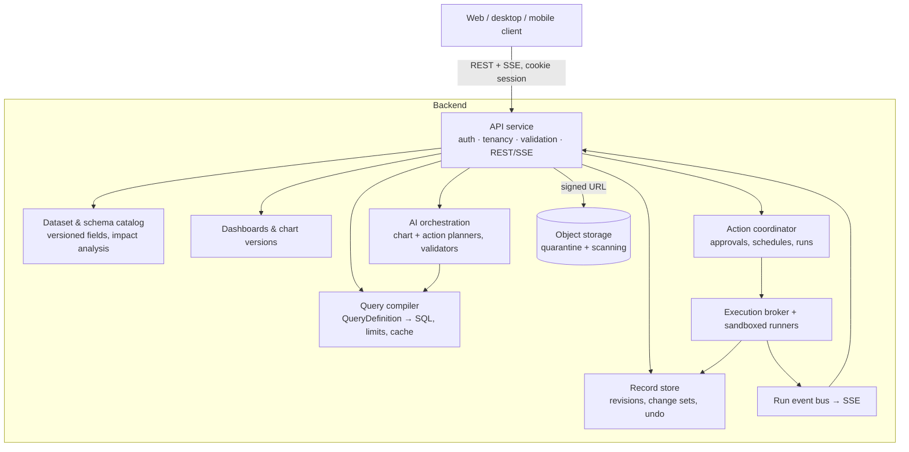

# Backend contract assumed by the web client

The web client is built against an API that does not exist yet. This document
says **what the backend must do** for the UI to work; it intentionally does
not prescribe _how_ (that is the C++ team's call — `../../design.md` has the
overall system design).

- Machine-readable contract: [`openapi.json`](./openapi.json) (OpenAPI 3.1, generated).
- Source of truth: `frontend/src/api/contract/*.ts` (Zod). Change it there.
- Reference behaviour: `frontend/src/mocks/` is a working in-memory
  implementation of every endpoint; `frontend/tests/contract/contract.test.ts`
  is an executable spec.
- Browse it in the app at **`/dev/api`**.

Where this API differs from the sketch in `design.md §11` it is deliberate; see
[§6](#6-differences-from-designmd-11).

## 1. Services the client assumes

| Capability         | Used by                          | Minimum behaviour                                                                                                                                                                                        |
| ------------------ | -------------------------------- | -------------------------------------------------------------------------------------------------------------------------------------------------------------------------------------------------------- |
| Identity & session | everything                       | Cookie session (`lh_session`), `GET /v1/session`; `401` + `{error:{code:"unauthenticated"}}` when expired. Login/logout at `/v1/auth/login?return_to=` and `/v1/auth/logout` (OIDC handled server-side). |
| Dataset catalog    | Data view, schema editor, charts | Stable field IDs; `schemaVersion` increments on publish; deprecate instead of delete.                                                                                                                    |
| Record store       | Grid, drawer, actions            | Per-record `revision`; `If-Match` enforcement; every write returns a `changeSetId`; change sets revertible.                                                                                              |
| Query compiler     | Grid queries, charts             | Validates the typed `QueryDefinition`/`RecordQuery` against schema + permissions; never accepts SQL.                                                                                                     |
| Dashboards         | Dashboard                        | Versioned dashboard; immutable chart versions; per-breakpoint layouts; soft-delete widgets.                                                                                                              |
| AI planners        | Chart builder, assistant         | Return **validated** artifacts only (`ChartDraft`, `ActionDraft`). Model output that fails validation must never be returned.                                                                            |
| Action coordinator | Assistant, Actions               | Dry runs on read-only snapshots, approvals bound to hash, schedules, kill switch, run history.                                                                                                           |
| Run events         | Assistant, Actions               | SSE stream per run.                                                                                                                                                                                      |
| Object storage     | Attachments                      | Pre-signed PUT, quarantine and scan before use.                                                                                                                                                          |

## 2. Conventions

| Convention             | Rule                                                                                                                                                                                                                           |
| ---------------------- | ------------------------------------------------------------------------------------------------------------------------------------------------------------------------------------------------------------------------------ |
| Base path / versioning | `/v1/…`. Breaking changes → `/v2`. Additive fields are non-breaking: the client ignores unknown fields.                                                                                                                        |
| IDs                    | Opaque strings (≤128 chars), stable forever. Never derive from names.                                                                                                                                                          |
| Timestamps             | RFC 3339 with offset (`2026-10-15T09:00:00Z`). Dates are `YYYY-MM-DD`.                                                                                                                                                         |
| Errors                 | Non-2xx with `{"error": {"code", "message", "requestId"?, "details"?}}`. Codes are listed in §3. Also send `X-Request-Id`.                                                                                                     |
| Pagination             | Cursor based: `{items, nextCursor}`; `nextCursor: null` on the last page. Cursors are opaque.                                                                                                                                  |
| Optimistic concurrency | Records: `If-Match: "<revision>"` header → `409 revision_conflict` with `details.current` = the current record. Schema and dashboards: `expectedSchemaVersion` / `expectedVersion` in the body → `409` with `details.current`. |
| Idempotency            | Endpoints marked idempotent require `Idempotency-Key`. A repeated key (same user + route) within 24 h returns the original response without repeating the side effect.                                                         |
| Streaming              | `text/event-stream`; each event is `data: <json>\n\n`. Server closes the stream after the terminal event. Send `: keep-alive` comments every ≤15 s.                                                                            |
| Auth                   | Cookies with `SameSite=Lax`, `Secure`; CSRF protection for unsafe methods (double-submit header is fine — tell us the header name). CORS must allow the web origin with credentials when hosted separately.                    |
| Limits                 | `rate_limited` (429) with `Retry-After`; `quota_exceeded` for AI/run budgets.                                                                                                                                                  |

## 3. Error codes

| Code                   | HTTP    | Client behaviour                                                        |
| ---------------------- | ------- | ----------------------------------------------------------------------- |
| `unauthenticated`      | 401     | Switch to signed-out screen.                                            |
| `forbidden`            | 403     | Show “no permission”; e.g. running a paused action.                     |
| `not_found`            | 404     | Not-found screen / toast.                                               |
| `validation_failed`    | 400/422 | Show message; for records include `details.fields: {fieldId: message}`. |
| `revision_conflict`    | 409     | Replace local copy with `details.current`, tell the user.               |
| `approval_invalidated` | 409     | Ask the user to preview again.                                          |
| `schema_incompatible`  | 422     | Widget shows _Needs attention_.                                         |
| `quota_exceeded`       | 402/429 | Show message.                                                           |
| `rate_limited`         | 429     | Auto-retry reads.                                                       |
| `unavailable`          | 503     | Auto-retry reads.                                                       |
| `internal`             | 500     | Generic error + request ID.                                             |

## 4. Endpoints

Full schemas are in `openapi.json`. ⟳ = requires `Idempotency-Key`; ⚑ = requires `If-Match`.

### Session

| Method & path                      | Purpose                                                                     |
| ---------------------------------- | --------------------------------------------------------------------------- |
| `GET /v1/session`                  | Current user + accessible workspaces.                                       |
| `GET /v1/workspaces/{workspaceId}` | Workspace, role, dataset summaries (with record counts), default dashboard. |

### Datasets & schema

| Method & path                                          | Purpose                                                                                                                                                                                                                         |
| ------------------------------------------------------ | ------------------------------------------------------------------------------------------------------------------------------------------------------------------------------------------------------------------------------- |
| `GET /v1/datasets/{datasetId}`                         | Dataset with fields, `schemaVersion`, `dataRevision`, health (`score`, `recordsNeedingReview`).                                                                                                                                 |
| `POST /v1/datasets/{datasetId}/schema-changes/preview` | **No side effects.** Body: `{expectedSchemaVersion, changes[]}`. Returns `SchemaImpact`: per-field conversion counts + up to 10 failing examples, dependent widgets/actions with effect, `requiresConfirmation`, human summary. |
| `POST /v1/datasets/{datasetId}/schema-changes` ⟳       | Apply the same body atomically. Returns new dataset + `changeSetId`. Failed conversions keep data reviewable (null value + record issue), dependents re-validated (`needs_attention`).                                          |

`SchemaChange` ops: `addField`, `renameField`, `changeFieldType`, `updateFieldConfig`, `deprecateField`, `restoreField`.

### Records

| Method & path                                          | Purpose                                                                                                                                                                                                                                                                                      |
| ------------------------------------------------------ | -------------------------------------------------------------------------------------------------------------------------------------------------------------------------------------------------------------------------------------------------------------------------------------------- |
| `POST /v1/datasets/{datasetId}/records/query`          | `RecordQuery {search?, filters[], sort[], onlyWithIssues, cursor?, limit≤500}` → `{items, nextCursor, totalCount, dataRevision}`. POST because filters are structured. Must stay fast at 1M rows (index on sort/filter fields; `totalCount` may be an estimate above a threshold — tell us). |
| `GET /v1/datasets/{datasetId}/records/{recordId}`      | One record.                                                                                                                                                                                                                                                                                  |
| `POST /v1/datasets/{datasetId}/records` ⟳              | Create; unspecified fields are null.                                                                                                                                                                                                                                                         |
| `PATCH /v1/datasets/{datasetId}/records/{recordId}` ⚑  | Partial update of `values`; increments `revision`.                                                                                                                                                                                                                                           |
| `DELETE /v1/datasets/{datasetId}/records/{recordId}` ⚑ | Delete (revertible).                                                                                                                                                                                                                                                                         |
| `POST /v1/change-sets/{changeSetId}/revert` ⟳          | Undo any change set (edit, delete, schema change, action commit).                                                                                                                                                                                                                            |

Record shape: `{id, revision, values: {fieldId: CellValue}, issues[], source: {kind, ref, label}, createdAt, updatedAt}`.
`CellValue` encoding per type is documented on the schema (money is a number in currency units; percent `0.25` = 25%; select values are **choice IDs**).

### Charts & dashboards

| Method & path                                                       | Purpose                                                                                                                                                                                                                             |
| ------------------------------------------------------------------- | ----------------------------------------------------------------------------------------------------------------------------------------------------------------------------------------------------------------------------------- |
| `POST /v1/chart-drafts`                                             | `{datasetId, prompt, refineDraftId?}` → `ChartDraft {definition, explanation, preview: QueryResult, warnings}`. The definition must already pass validation (fields exist and are authorised, aggregations fit types, cost limits). |
| `GET /v1/dashboards/{dashboardId}`                                  | `{version, widgets[], layouts: {lg, md, sm}}`. Widgets are `chart` (immutable `chartVersionId` + definition) or `dataHealth`.                                                                                                       |
| `PUT /v1/dashboards/{dashboardId}/layout`                           | `{expectedVersion, layouts}`; reject unknown widget IDs.                                                                                                                                                                            |
| `POST /v1/dashboards/{dashboardId}/widgets` ⟳                       | `{chartDraftId}` → publishes that exact draft as a new chart version, places it; returns dashboard + `widgetId`.                                                                                                                    |
| `POST …/widgets/{widgetId}/duplicate` ⟳                             | Copy sharing the chart version.                                                                                                                                                                                                     |
| `DELETE …/widgets/{widgetId}` / `POST …/widgets/{widgetId}/restore` | Soft delete / undo.                                                                                                                                                                                                                 |
| `GET …/widgets/{widgetId}/data`                                     | Runs the widget's query → `QueryResult {columns, rows, meta: {datasetRevision, generatedAt, truncated}}`. Cache key: tenant + chart version + data revision + auth scope. `schema_incompatible` if broken.                          |

`QueryDefinition`: `{datasetId, select[{as, fieldId?, aggregate?, bucket?}], filters[], groupBy[alias], orderBy[{by, direction}], limit≤1000}`.
Result rows: dimension columns return **display values** (choice labels, bucket start date `YYYY-MM-DD`); measures are numbers.

### Actions & runs

| Method & path                                                 | Purpose                                                                                                                                                                                                                     |
| ------------------------------------------------------------- | --------------------------------------------------------------------------------------------------------------------------------------------------------------------------------------------------------------------------- |
| `POST /v1/workspaces/{workspaceId}/action-drafts`             | `{prompt, attachmentIds[], datasetId?, actionId?}` → `ActionDraft` with `status: ready \| needs_input \| rejected`, interpretation, steps, manifest (permissions + limits) and `hash`.                                      |
| `POST /v1/action-drafts/{draftId}/dry-runs` ⟳                 | Start a dry run on a read-only snapshot → `Run` (202).                                                                                                                                                                      |
| `POST /v1/action-drafts/{draftId}/approve` ⟳                  | `{hash, dryRunId, runNow}`. Must reject with `approval_invalidated` unless `hash` equals the draft's current hash **and** `dryRunId` is a succeeded dry run of that hash. Creates a new `ActionVersion`; optional live run. |
| `GET /v1/workspaces/{workspaceId}/actions`                    | Approved actions with schedule and last run.                                                                                                                                                                                |
| `GET /v1/actions/{actionId}` / `PATCH /v1/actions/{actionId}` | Read; pause/resume (`status`). Paused = no scheduled or manual runs (`forbidden`).                                                                                                                                          |
| `PUT /v1/actions/{actionId}/schedule`                         | `{cron (5-field), timezone (IANA), enabled}`; server returns `description` and `nextRunAt`. Enabling is audited as its own approval.                                                                                        |
| `POST /v1/actions/{actionId}/runs` ⟳                          | Manual live run of the current approved version.                                                                                                                                                                            |
| `GET /v1/actions/{actionId}/runs`                             | `?cursor&limit` → run history, newest first.                                                                                                                                                                                |
| `GET /v1/runs/{runId}`                                        | Run snapshot.                                                                                                                                                                                                               |
| `GET /v1/runs/{runId}/events`                                 | **SSE**: replay logs so far, then `{"type":"run.updated","run":Run}` on every state change and `{"type":"log",…}` lines; close after terminal status.                                                                       |
| `POST /v1/runs/{runId}/cancel`                                | Cancel; staged changes discarded.                                                                                                                                                                                           |

A `Run` carries `artifactHash` (exact version executed), per-step status, and
`changes: ProposedChanges {inserts, updates, duplicatesSkipped, rejected, sample[≤50], committed, changeSetId}`.
Live runs commit atomically on success; failures leave no partial writes.

### Uploads

| Method & path                                 | Purpose                                                                                                                                                   |
| --------------------------------------------- | --------------------------------------------------------------------------------------------------------------------------------------------------------- |
| `POST /v1/workspaces/{workspaceId}/uploads` ⟳ | `{filename, contentType ∈ png/jpeg/webp/heic/pdf/csv, size ≤ 20 MB}` → `{upload, uploadUrl, method:"PUT", headers, expiresAt}` (pre-signed, short-lived). |
| `PUT <uploadUrl>`                             | Browser uploads bytes directly to object storage (CORS must allow it).                                                                                    |
| `POST /v1/uploads/{uploadId}/complete`        | Verify type/size, scan; `status: quarantined → ready \| rejected`.                                                                                        |

## 5. Non-functional expectations from the UI

- p95 latency: reads < 300 ms, record writes < 300 ms, `records/query` first page < 500 ms at 1M rows, chart draft < 8 s.
- SSE through proxies: disable buffering (`X-Accel-Buffering: no`), heartbeats ≤ 15 s.
- All writes and AI calls auditable via `requestId`.
- Tenancy enforced server-side on every ID; the client never sends a tenant ID.

## 6. Differences from `design.md §11`

| design.md                                            | This contract                                                                                | Why                                                                                                          |
| ---------------------------------------------------- | -------------------------------------------------------------------------------------------- | ------------------------------------------------------------------------------------------------------------ |
| `GET /records?cursor=`                               | `POST /records/query`                                                                        | Structured filters/sort don't fit in a query string; same semantics.                                         |
| `POST /schema-drafts`, `/schema-drafts/{id}/publish` | `schema-changes/preview` + `schema-changes` with `expectedSchemaVersion`                     | No server-side draft object to garbage-collect; optimistic concurrency covers the race.                      |
| `chart-drafts/{id}/preview`, `/publish`              | Draft response includes the preview; publish = `POST dashboards/{id}/widgets {chartDraftId}` | One round-trip fewer; publishing is always “onto a dashboard”.                                               |
| `action-versions/{id}/approve`, `enable-schedule`    | `action-drafts/{id}/approve {hash, dryRunId}`, `PUT actions/{id}/schedule`                   | Approval binds to hash **and** a successful preview; schedule is a separate, explicit call as in the design. |
| —                                                    | `change-sets/{id}/revert`                                                                    | Gives every write (incl. action commits) a uniform Undo.                                                     |
| —                                                    | `runs/{id}/cancel`, `actions/{id}` PATCH (pause)                                             | Kill switches required by the security model.                                                                |

## 7. Open questions for the backend team

1. Is `totalCount` exact at scale, or should the contract add `totalCountIsEstimate`?
2. CSRF mechanism and header name.
3. Should chart drafts stream tokens (SSE) as the design suggests? The client can support it with the same SSE reader.
4. Retention for drafts and dry-run staged data (the UI assumes ≥ 24 h).
5. Multi-dataset workspaces: the UI lists all datasets but the assistant currently passes the first as context.
